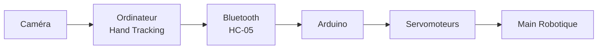
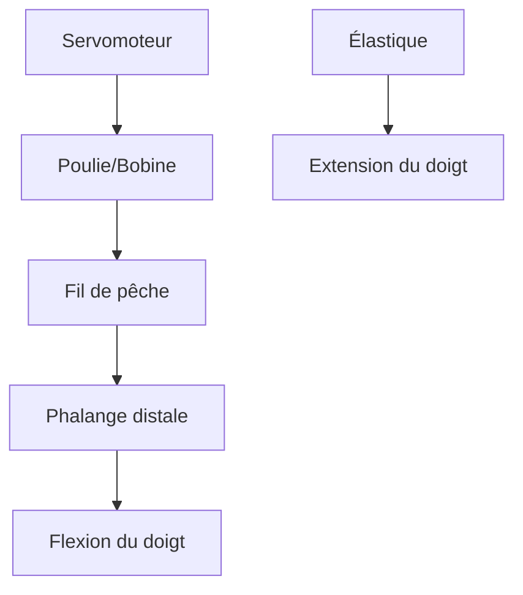
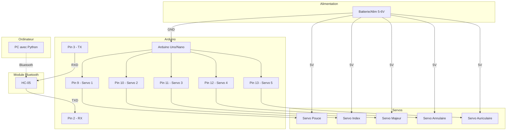
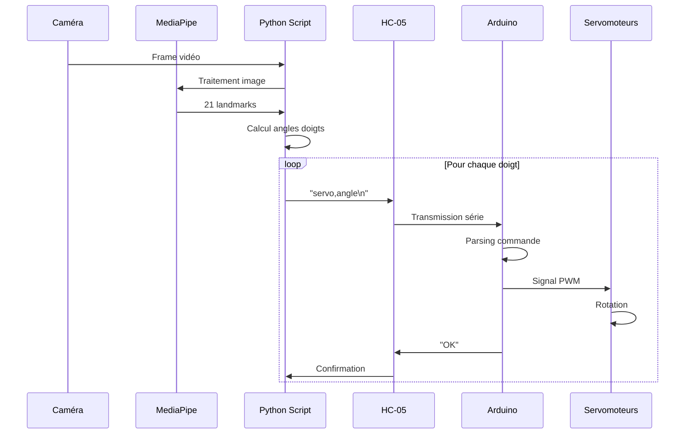

# Documentation du Projet Hand Bot

## Table des Matières
1. [Introduction](#introduction)
2. [Partie Mécanique et Modélisation 3D](#partie-mécanique-et-modélisation-3d)
3. [Partie Électronique](#partie-électronique)
4. [Partie Informatique](#partie-informatique)

---

## Introduction

### Présentation du Projet

Le **Hand Bot** est un projet de main robotique contrôlée par reconnaissance gestuelle (hand tracking). Ce système permet de reproduire les mouvements d'une main humaine captés par une caméra sur une main robotique articulée, créant ainsi une interface homme-machine intuitive et naturelle.

### Objectifs

- **Contrôle gestuel** : Utiliser la vision par ordinateur pour détecter et suivre les mouvements de la main
- **Communication sans fil** : Transmettre les commandes via Bluetooth (module HC-05)
- **Actionnement mécanique** : Reproduire les mouvements des doigts grâce à des servomoteurs
- **Système temps réel** : Assurer une réactivité immédiate entre le geste et l'action

### Architecture Globale du Système



Le système se compose de trois parties principales :
1. **Partie informatique** : Capture vidéo et traitement des gestes
2. **Partie électronique** : Réception des commandes et contrôle des servomoteurs
3. **Partie mécanique** : Structure physique de la main et système de traction

---

## Partie Mécanique et Modélisation 3D

### Vue d'Ensemble de la Structure

La main robotique est constituée de pièces imprimées en 3D assemblées pour former une structure articulée capable de reproduire les mouvements des doigts humains.


### Composants Mécaniques Principaux

#### 1. Structure de la Main

La main est composée de plusieurs éléments :

- **Paume** : Base rigide servant de support pour tous les doigts
- **Doigts articulés** : Chaque doigt possède plusieurs phalanges reliées par des articulations
- **Poignet** : Point de fixation de la main à une base stable


#### 2. Système de Traction par Fil de Pêche

Le mouvement des doigts est assuré par un système de traction utilisant du **fil de pêche** (ou fil de nylon résistant).

**Principe de fonctionnement :**



**Caractéristiques du fil de pêche :**
- **Résistance** : Supporte la tension sans se rompre
- **Flexibilité** : Permet de passer dans les guides et articulations
- **Faible friction** : Glisse facilement pour un mouvement fluide
- **Diamètre** : Généralement 0.3-0.5mm pour un bon compromis résistance/flexibilité

**Trajet du fil :**
1. Le fil part du servomoteur (enroulé sur une poulie)
2. Passe à travers des guides le long de la paume
3. Traverse les articulations du doigt
4. Se fixe à l'extrémité de la phalange distale (bout du doigt)

**Action :**
- Lorsque le servomoteur tire le fil → le doigt se **ferme** (flexion)
- Lorsque le servomoteur relâche le fil → le doigt s'**ouvre** (extension grâce aux élastiques)


#### 3. Système de Retour par Élastiques

Les **élastiques** jouent un rôle crucial dans le mécanisme :

**Rôle des élastiques :**
- **Retour automatique** : Ramènent les doigts en position ouverte (extension) quand le fil est relâché
- **Force antagoniste** : Créent une tension opposée à celle du fil de pêche
- **Stabilisation** : Maintiennent les doigts dans une position neutre au repos

**Placement :**
- Fixés sur la face dorsale (dessus) des doigts
- Relient les phalanges entre elles ou à la paume
- Créent une force de traction vers l'arrière

**Principe biomimétique :**
Ce système imite le fonctionnement des muscles fléchisseurs et extenseurs de la main humaine :
- **Fil de pêche** = Tendons fléchisseurs (ferment la main)
- **Élastiques** = Tendons extenseurs (ouvrent la main)


### Fichiers de Modélisation 3D

> [!NOTE]
> Les fichiers STL présents dans le dossier `Spider robot(quad robot, quadruped)-SG90 - 1009659` concernent un projet de robot araignée et ne correspondent pas directement à la main robotique. Les pièces de la main ont probablement été modélisées séparément ou proviennent d'un autre design.

**Pièces typiques d'une main robotique imprimée en 3D :**
- Segments de phalanges (proximale, médiane, distale)
- Paume avec guides pour les fils
- Supports pour servomoteurs
- Poulies ou bobines pour l'enroulement du fil
- Articulations (axes ou charnières)

### Assemblage Mécanique

**Étapes d'assemblage recommandées :**

1. **Impression des pièces** : Imprimer toutes les pièces en PLA ou ABS
2. **Assemblage des doigts** : Relier les phalanges avec des axes ou vis
3. **Installation des élastiques** : Fixer les élastiques sur la face dorsale
4. **Passage des fils** : Enfiler le fil de pêche à travers les guides
5. **Fixation des servomoteurs** : Monter les servos sur la base
6. **Connexion fils-servos** : Attacher les fils aux poulies des servomoteurs
7. **Réglage de la tension** : Ajuster la tension des fils et élastiques

---

## Partie Électronique

### Liste des Composants

| Composant | Modèle/Type | Quantité | Rôle |
|-----------|-------------|----------|------|
| Microcontrôleur | Arduino (Uno/Nano) | 1 | Contrôle des servomoteurs |
| Module Bluetooth | HC-05 | 1 | Communication sans fil |
| Servomoteurs | SG90 ou équivalent | 5 | Actionnement des doigts |
| Alimentation | 5-6V, 2-3A | 1 | Alimentation des servos |
| Câbles | Jumper wires | - | Connexions |


### Description des Composants

#### 1. Arduino (Microcontrôleur)

**Rôle :**
- Reçoit les commandes via le module Bluetooth
- Traite les données (angles des doigts)
- Génère les signaux PWM pour contrôler les servomoteurs
- Gère la communication série

**Caractéristiques utilisées :**
- Ports série (RX/TX) pour le HC-05
- Sorties PWM (pins 9, 10, 11, etc.) pour les servos
- Alimentation 5V pour les composants

#### 2. Module Bluetooth HC-05

**Rôle :**
- Établit une liaison Bluetooth avec l'ordinateur
- Reçoit les commandes d'angle envoyées par le script Python
- Transmet les données à l'Arduino via UART (communication série)

**Spécifications :**
- **Protocole** : Bluetooth 2.0 SPP (Serial Port Profile)
- **Portée** : ~10 mètres
- **Vitesse** : 9600 bauds (configurable)
- **Tension** : 3.3V (utilise un diviseur de tension si connecté à 5V)

**Pins du HC-05 :**
- **VCC** : Alimentation 3.3-5V
- **GND** : Masse
- **TXD** : Transmission de données (vers RX Arduino)
- **RXD** : Réception de données (depuis TX Arduino)
- **EN** : Enable (pour mode AT)
- **STATE** : Indicateur d'état de connexion

#### 3. Servomoteurs (SG90)

**Rôle :**
- Convertissent les signaux PWM en mouvement rotatif
- Tirent ou relâchent les fils de pêche
- Contrôlent l'angle de flexion de chaque doigt

**Spécifications SG90 :**
- **Angle** : 0-180°
- **Couple** : ~1.8 kg·cm
- **Vitesse** : ~0.1s/60°
- **Tension** : 4.8-6V
- **Courant** : ~100-200mA par servo (jusqu'à 500mA en charge)

**Connexions :**
- **Fil marron/noir** : GND
- **Fil rouge** : VCC (5V)
- **Fil orange/jaune** : Signal PWM

> [!WARNING]
> **Alimentation des servomoteurs :** Ne PAS alimenter 5 servos directement depuis l'Arduino (risque de surcharge). Utiliser une alimentation externe avec masse commune.

### Schéma de Branchement



**Tableau de connexions détaillé :**

| HC-05 | Arduino | Notes |
|-------|---------|-------|
| VCC | 5V | Alimentation |
| GND | GND | Masse commune |
| TXD | Pin 2 (RX) | HC-05 → Arduino |
| RXD | Pin 3 (TX) | Arduino → HC-05 |

| Servomoteur | Arduino | Alimentation Externe |
|-------------|---------|---------------------|
| Servo 1 (Signal) | Pin 9 | - |
| Servo 2 (Signal) | Pin 10 | - |
| Servo 3 (Signal) | Pin 11 | - |
| Servo 4 (Signal) | Pin 12 | - |
| Servo 5 (Signal) | Pin 13 | - |
| Tous (VCC) | - | +5V |
| Tous (GND) | GND | GND (masse commune) |


### Configuration du Module HC-05

#### Appairage Bluetooth

**Depuis Linux (utilisé dans le projet) :**

Le script `start_hc05.sh` automatise la connexion :

```bash
#!/bin/bash

echo "Démarrage de la connexion HC-05..."

# Nettoyer les anciennes connexions
sudo killall rfcomm 2>/dev/null
sudo rfcomm release /dev/rfcomm0 2>/dev/null

sleep 1

# Bind
sudo rfcomm bind /dev/rfcomm0 98:D3:32:10:54:AE 1
sudo chmod 666 /dev/rfcomm0

# Boucle de reconnexion automatique
while true; do
    echo "Connexion en cours..."
    sudo rfcomm connect /dev/rfcomm0 98:D3:32:10:54:AE 1
    echo "Connexion perdue, reconnexion dans 2 secondes..."
    sleep 2
done
```

**Étapes manuelles :**

1. **Scanner les appareils Bluetooth :**
   ```bash
   bluetoothctl
   scan on
   ```

2. **Appairer le HC-05 :**
   ```bash
   pair 98:D3:32:10:54:AE
   # Code PIN par défaut : 1234 ou 0000
   ```

3. **Créer le port série virtuel :**
   ```bash
   sudo rfcomm bind /dev/rfcomm0 98:D3:32:10:54:AE 1
   ```

#### Configuration en Mode AT

Pour modifier les paramètres du HC-05 (nom, vitesse, code PIN) :

1. **Entrer en mode AT :**
   - Maintenir le bouton EN enfoncé
   - Alimenter le module
   - La LED clignote lentement (2s)

2. **Connecter via série à 38400 bauds**

3. **Commandes AT utiles :**
   ```
   AT                    # Test
   AT+NAME=HandBot       # Changer le nom
   AT+PSWD=1234         # Changer le PIN
   AT+UART=9600,0,0     # Vitesse 9600 bauds
   AT+ROLE=0            # Mode esclave
   ```

> [!TIP]
> La vitesse configurée en mode AT (9600 bauds) doit correspondre à celle utilisée dans le code Arduino et Python.

### Description du Code Arduino

Le code Arduino reçoit les commandes d'angle via Bluetooth et contrôle les servomoteurs.

#### Code Complet Commenté

```cpp
#include <SoftwareSerial.h>
#include <Servo.h>

// Configuration de la communication Bluetooth
SoftwareSerial bluetooth(2, 3); // RX=Pin2, TX=Pin3

// Déclaration du servomoteur
Servo servo;

// Buffer pour stocker les données reçues
String data = "";

void setup() {
  // Initialisation de la communication série (pour debug)
  Serial.begin(9600);
  
  // Initialisation du Bluetooth à 9600 bauds
  bluetooth.begin(9600);
  
  // Attachement du servo sur le pin 9
  servo.attach(9);
  
  // Position initiale au milieu (90°)
  servo.write(90);
  
  // Messages de démarrage
  Serial.println("=== Système de contrôle servo Bluetooth ===");
  Serial.println("En attente de connexion...");
}

void loop() {
  // Vérifier si des données sont disponibles sur le Bluetooth
  while (bluetooth.available()) {
    // Lire un caractère
    char c = bluetooth.read();
    
    // Si c'est un retour à la ligne, traiter la commande
    if (c == '\n') {
      // Convertir la chaîne en entier (angle)
      int angle = data.toInt();
      
      // Vérifier que l'angle est valide (0-180°)
      if (angle >= 0 && angle <= 180) {
        // Déplacer le servo à l'angle demandé
        servo.write(angle);
        
        // Afficher dans le moniteur série
        Serial.print("✓ Angle reçu: ");
        Serial.println(angle);
        
        // Envoyer une confirmation au PC
        bluetooth.println("OK");
      } else {
        // Angle invalide
        Serial.println("✗ Angle invalide");
        bluetooth.println("ERREUR");
      }
      
      // Réinitialiser le buffer
      data = "";
    } else {
      // Accumuler les caractères reçus
      data += c;
    }
  }
}
```

#### Fonctionnement Détaillé

**1. Initialisation (`setup()`) :**
- Configure la communication série USB (9600 bauds) pour le debug
- Configure la communication Bluetooth (9600 bauds) via SoftwareSerial
- Attache le servomoteur au pin 9
- Place le servo en position neutre (90°)

**2. Boucle principale (`loop()`) :**
- Vérifie en continu si des données arrivent via Bluetooth
- Accumule les caractères reçus dans un buffer (`data`)
- Quand un `\n` est détecté :
  - Convertit la chaîne en angle (entier)
  - Valide l'angle (0-180°)
  - Commande le servomoteur
  - Envoie une confirmation ("OK" ou "ERREUR")

**3. Protocole de communication :**
```
PC → HC-05 → Arduino : "90\n"
Arduino → HC-05 → PC : "OK\n"
```

#### Extension pour 5 Servomoteurs

Pour contrôler une main complète avec 5 doigts :

```cpp
#include <SoftwareSerial.h>
#include <Servo.h>

SoftwareSerial bluetooth(2, 3);

// Déclaration de 5 servos
Servo servo1, servo2, servo3, servo4, servo5;

String data = "";

void setup() {
  Serial.begin(9600);
  bluetooth.begin(9600);
  
  // Attacher les 5 servos
  servo1.attach(9);   // Pouce
  servo2.attach(10);  // Index
  servo3.attach(11);  // Majeur
  servo4.attach(12);  // Annulaire
  servo5.attach(13);  // Auriculaire
  
  // Position initiale
  servo1.write(90);
  servo2.write(90);
  servo3.write(90);
  servo4.write(90);
  servo5.write(90);
  
  Serial.println("Main robotique prête !");
}

void loop() {
  while (bluetooth.available()) {
    char c = bluetooth.read();
    
    if (c == '\n') {
      // Format attendu : "servo,angle" ex: "1,90"
      int commaIndex = data.indexOf(',');
      
      if (commaIndex > 0) {
        int servoNum = data.substring(0, commaIndex).toInt();
        int angle = data.substring(commaIndex + 1).toInt();
        
        if (angle >= 0 && angle <= 180) {
          // Sélectionner le bon servo
          switch(servoNum) {
            case 1: servo1.write(angle); break;
            case 2: servo2.write(angle); break;
            case 3: servo3.write(angle); break;
            case 4: servo4.write(angle); break;
            case 5: servo5.write(angle); break;
          }
          
          Serial.print("Servo ");
          Serial.print(servoNum);
          Serial.print(" → ");
          Serial.println(angle);
          
          bluetooth.println("OK");
        }
      }
      
      data = "";
    } else {
      data += c;
    }
  }
}
```

---

## Partie Informatique

### Architecture Logicielle

Le système informatique se compose de deux parties principales :
1. **Hand tracking** : Détection et suivi de la main via caméra
2. **Communication Bluetooth** : Envoi des commandes à l'Arduino

### Technologies Utilisées

- **Python 3** : Langage principal
- **OpenCV** : Capture vidéo (optionnel)
- **MediaPipe** : Hand tracking (recommandé)
- **PySerial** : Communication série avec le HC-05

### Code Python Actuel

Le code actuel (`hand_bot.py`) gère la communication Bluetooth avec l'Arduino :

```python
import serial
import time

PORT = '/dev/rfcomm0'
BAUD_RATE = 9600

def connect_bluetooth():
    """Établit la connexion Bluetooth"""
    try:
        bt = serial.Serial(PORT, BAUD_RATE, timeout=1)
        time.sleep(1)
        return bt
    except serial.SerialException as e:
        print(f"✗ Erreur de connexion: {e}")
        return None

print("Connexion au HC-05...")
bluetooth = connect_bluetooth()

if bluetooth is None:
    print("Impossible de se connecter. Vérifie que rfcomm est actif.")
    exit(1)

print("✓ Connexion établie!")
print("=" * 40)
print("Contrôle du servomoteur via Bluetooth")
print("=" * 40)

while True:
    try:
        angle = input("\nEntrer un angle (0-180) ou 'q' pour quitter : ")
        
        if angle.lower() == 'q':
            print("Fermeture...")
            break
        
        if angle.isdigit():
            angle_int = int(angle)
            if 0 <= angle_int <= 180:
                # Envoyer l'angle
                try:
                    bluetooth.write(f"{angle_int}\n".encode())
                    print(f"→ Angle {angle_int}° envoyé")
                    
                    time.sleep(0.1)
                    if bluetooth.in_waiting > 0:
                        response = bluetooth.readline().decode().strip()
                        print(f"← Arduino répond: {response}")
                
                except (serial.SerialException, OSError) as e:
                    print(f"✗ Connexion perdue : {e}")
                    print("Tentative de reconnexion...")
                    
                    # Fermer l'ancienne connexion
                    try:
                        bluetooth.close()
                    except:
                        pass
                    
                    # Attendre un peu
                    time.sleep(2)
                    
                    # Reconnecter
                    bluetooth = connect_bluetooth()
                    if bluetooth is None:
                        print("✗ Reconnexion échouée. Relance le script.")
                        break
                    
                    print("✓ Reconnecté ! Réessaie ta commande.")
                    
            else:
                print("✗ Angle invalide (doit être entre 0 et 180)")
        else:
            print("✗ Entrée invalide (entrez un nombre)")
    
    except KeyboardInterrupt:
        print("\n\nInterruption par l'utilisateur")
        break

# Fermeture propre
try:
    bluetooth.close()
except:
    pass
print("Connexion fermée.")
```

### Fonctionnalités du Code Actuel

**1. Connexion Bluetooth :**
- Établit la connexion avec `/dev/rfcomm0`
- Gère les erreurs de connexion
- Timeout de 1 seconde

**2. Envoi de Commandes :**
- Interface en ligne de commande
- Validation des angles (0-180°)
- Format : `"angle\n"` (ex: `"90\n"`)

**3. Gestion des Erreurs :**
- Reconnexion automatique en cas de perte de connexion
- Validation des entrées utilisateur
- Fermeture propre à l'interruption

**4. Feedback :**
- Affichage des angles envoyés
- Réception des confirmations de l'Arduino
- Messages d'état clairs

### Intégration du Hand Tracking

Pour transformer ce code en système de contrôle gestuel, il faut ajouter la détection de main avec **MediaPipe**.

#### Installation des Dépendances

```bash
pip install opencv-python mediapipe pyserial
```

#### Code Complet avec Hand Tracking

```python
import cv2
import mediapipe as mp
import serial
import time
import math

# Configuration Bluetooth
PORT = '/dev/rfcomm0'
BAUD_RATE = 9600

# Initialisation MediaPipe
mp_hands = mp.solutions.hands
mp_drawing = mp.solutions.drawing_utils
hands = mp_hands.Hands(
    static_image_mode=False,
    max_num_hands=1,
    min_detection_confidence=0.7,
    min_tracking_confidence=0.5
)

def connect_bluetooth():
    """Établit la connexion Bluetooth"""
    try:
        bt = serial.Serial(PORT, BAUD_RATE, timeout=1)
        time.sleep(1)
        return bt
    except serial.SerialException as e:
        print(f"✗ Erreur de connexion: {e}")
        return None

def calculate_finger_angle(landmarks, finger_points):
    """
    Calcule l'angle de flexion d'un doigt
    finger_points : liste des indices des landmarks du doigt
    Retourne un angle entre 0 (fermé) et 180 (ouvert)
    """
    # Points du doigt (base, milieu, bout)
    base = landmarks[finger_points[0]]
    middle = landmarks[finger_points[2]]
    tip = landmarks[finger_points[3]]
    
    # Calculer la distance entre la base et le bout
    distance = math.sqrt(
        (tip.x - base.x)**2 + 
        (tip.y - base.y)**2
    )
    
    # Mapper la distance sur un angle (0-180)
    # Plus le doigt est fermé, plus la distance est petite
    angle = int(distance * 500)  # Facteur d'échelle à ajuster
    angle = max(0, min(180, angle))  # Limiter entre 0 et 180
    
    return angle

def get_finger_angles(hand_landmarks):
    """
    Extrait les angles de tous les doigts
    Retourne un dictionnaire {doigt: angle}
    """
    # Indices des landmarks pour chaque doigt
    fingers = {
        'pouce': [1, 2, 3, 4],      # Thumb
        'index': [5, 6, 7, 8],       # Index
        'majeur': [9, 10, 11, 12],   # Middle
        'annulaire': [13, 14, 15, 16], # Ring
        'auriculaire': [17, 18, 19, 20] # Pinky
    }
    
    angles = {}
    for finger_name, points in fingers.items():
        angle = calculate_finger_angle(hand_landmarks.landmark, points)
        angles[finger_name] = angle
    
    return angles

# Connexion Bluetooth
print("Connexion au HC-05...")
bluetooth = connect_bluetooth()

if bluetooth is None:
    print("Impossible de se connecter. Vérifie que rfcomm est actif.")
    exit(1)

print("✓ Connexion établie!")

# Initialisation de la caméra
cap = cv2.VideoCapture(0)
cap.set(cv2.CAP_PROP_FRAME_WIDTH, 640)
cap.set(cv2.CAP_PROP_FRAME_HEIGHT, 480)

print("=" * 50)
print("Hand Tracking activé - Appuyez sur 'q' pour quitter")
print("=" * 50)

while cap.isOpened():
    success, frame = cap.read()
    if not success:
        print("Impossible de lire la caméra")
        break
    
    # Retourner l'image horizontalement pour effet miroir
    frame = cv2.flip(frame, 1)
    
    # Convertir BGR vers RGB
    rgb_frame = cv2.cvtColor(frame, cv2.COLOR_BGR2RGB)
    
    # Traiter l'image avec MediaPipe
    results = hands.process(rgb_frame)
    
    # Si une main est détectée
    if results.multi_hand_landmarks:
        for hand_landmarks in results.multi_hand_landmarks:
            # Dessiner les landmarks sur l'image
            mp_drawing.draw_landmarks(
                frame, 
                hand_landmarks, 
                mp_hands.HAND_CONNECTIONS
            )
            
            # Calculer les angles des doigts
            angles = get_finger_angles(hand_landmarks)
            
            # Envoyer les angles via Bluetooth
            try:
                # Format : "servo,angle\n" pour chaque doigt
                finger_to_servo = {
                    'pouce': 1,
                    'index': 2,
                    'majeur': 3,
                    'annulaire': 4,
                    'auriculaire': 5
                }
                
                for finger, angle in angles.items():
                    servo_num = finger_to_servo[finger]
                    command = f"{servo_num},{angle}\n"
                    bluetooth.write(command.encode())
                
                # Afficher les angles sur l'image
                y_offset = 30
                for finger, angle in angles.items():
                    text = f"{finger}: {angle}°"
                    cv2.putText(
                        frame, text, (10, y_offset),
                        cv2.FONT_HERSHEY_SIMPLEX, 0.6,
                        (0, 255, 0), 2
                    )
                    y_offset += 30
                    
            except (serial.SerialException, OSError) as e:
                print(f"✗ Erreur Bluetooth : {e}")
                # Tentative de reconnexion
                bluetooth = connect_bluetooth()
                if bluetooth is None:
                    break
    
    # Afficher l'image
    cv2.imshow('Hand Bot - Hand Tracking', frame)
    
    # Quitter avec 'q'
    if cv2.waitKey(5) & 0xFF == ord('q'):
        break

# Nettoyage
cap.release()
cv2.destroyAllWindows()
hands.close()
bluetooth.close()
print("Système arrêté.")
```

### Fonctionnement du Hand Tracking

#### 1. Détection de la Main (MediaPipe)

MediaPipe détecte **21 landmarks** (points de repère) sur la main :

```
        8   12  16  20
        |   |   |   |
    4   7   11  15  19
    |   |   |   |   |
    3   6   10  14  18
    |   |   |   |   |
    2   5   9   13  17
    |   |___|___|___|
    1       |
    |       0 (poignet)
    0
```

**Landmarks par doigt :**
- **Pouce** : 1, 2, 3, 4
- **Index** : 5, 6, 7, 8
- **Majeur** : 9, 10, 11, 12
- **Annulaire** : 13, 14, 15, 16
- **Auriculaire** : 17, 18, 19, 20

#### 2. Calcul des Angles

**Méthode utilisée :**
- Mesurer la distance entre la base du doigt et son extrémité
- Plus le doigt est fermé → distance faible → angle faible
- Plus le doigt est ouvert → distance grande → angle élevé

**Formule :**
```python
distance = sqrt((tip.x - base.x)² + (tip.y - base.y)²)
angle = distance × facteur_échelle
angle = clamp(angle, 0, 180)
```

**Alternative (angle géométrique) :**
Calculer l'angle réel entre les segments du doigt :
```python
import numpy as np

def angle_between_points(a, b, c):
    """Angle au point b formé par a-b-c"""
    ba = np.array([a.x - b.x, a.y - b.y])
    bc = np.array([c.x - b.x, c.y - b.y])
    
    cosine = np.dot(ba, bc) / (np.linalg.norm(ba) * np.linalg.norm(bc))
    angle = np.arccos(cosine)
    
    return np.degrees(angle)
```

#### 3. Envoi des Commandes

**Protocole de communication :**
```
Format : "servo_num,angle\n"
Exemple : "2,120\n" → Servo 2 (index) à 120°
```

**Fréquence d'envoi :**
- Environ 30 fois par seconde (selon la caméra)
- Possibilité d'ajouter un filtre pour éviter les envois inutiles :

```python
# Envoyer seulement si l'angle a changé de plus de 5°
last_angles = {f: 0 for f in fingers}

for finger, angle in angles.items():
    if abs(angle - last_angles[finger]) > 5:
        # Envoyer la commande
        bluetooth.write(f"{servo_num},{angle}\n".encode())
        last_angles[finger] = angle
```

### Optimisations et Améliorations

#### 1. Lissage des Angles

Pour éviter les tremblements :

```python
from collections import deque

# File de lissage (moyenne mobile)
angle_buffers = {f: deque(maxlen=5) for f in fingers}

for finger, angle in angles.items():
    angle_buffers[finger].append(angle)
    smoothed_angle = int(sum(angle_buffers[finger]) / len(angle_buffers[finger]))
    # Utiliser smoothed_angle
```

#### 2. Calibration

Permettre à l'utilisateur de calibrer les angles min/max :

```python
# Mode calibration
calibration_mode = True
min_angles = {f: 180 for f in fingers}
max_angles = {f: 0 for f in fingers}

if calibration_mode:
    for finger, angle in angles.items():
        min_angles[finger] = min(min_angles[finger], angle)
        max_angles[finger] = max(max_angles[finger], angle)

# Mapper les angles calibrés sur 0-180
def map_angle(angle, finger):
    min_val = min_angles[finger]
    max_val = max_angles[finger]
    mapped = (angle - min_val) / (max_val - min_val) * 180
    return int(max(0, min(180, mapped)))
```

#### 3. Détection de Gestes

Ajouter des gestes prédéfinis :

```python
def detect_gesture(angles):
    """Détecte des gestes spécifiques"""
    # Poing fermé
    if all(angle < 30 for angle in angles.values()):
        return "POING"
    
    # Main ouverte
    if all(angle > 150 for angle in angles.values()):
        return "OUVERT"
    
    # Pouce levé
    if angles['pouce'] > 150 and all(angles[f] < 30 for f in ['index', 'majeur', 'annulaire', 'auriculaire']):
        return "POUCE_LEVE"
    
    return "NEUTRE"

gesture = detect_gesture(angles)
print(f"Geste détecté : {gesture}")
```

### Diagramme de Flux du Système Complet



---

## Conclusion

Ce projet **Hand Bot** combine mécanique, électronique et informatique pour créer un système de contrôle gestuel intuitif. La main robotique reproduit les mouvements captés par caméra grâce à :

- **Système mécanique** : Fil de pêche et élastiques pour un mouvement biomimétique
- **Système électronique** : Arduino et HC-05 pour le contrôle sans fil
- **Système informatique** : MediaPipe et Python pour le hand tracking en temps réel

### Améliorations Possibles

1. **Retour haptique** : Ajouter des capteurs de force sur les doigts
2. **Contrôle bilatéral** : Sentir la résistance des objets saisis
3. **Apprentissage automatique** : Reconnaissance de gestes complexes
4. **Interface graphique** : Application avec visualisation 3D
5. **Multi-mains** : Contrôler deux mains robotiques simultanément

### Ressources Supplémentaires

- [Documentation MediaPipe Hands](https://google.github.io/mediapipe/solutions/hands.html)
- [Tutoriel Arduino Servo](https://www.arduino.cc/en/Reference/Servo)
- [Guide HC-05](https://components101.com/wireless/hc-05-bluetooth-module)

---

**Projet réalisé en 2025**
